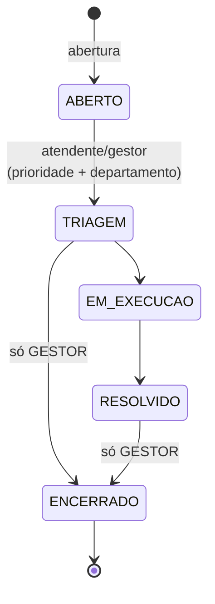

# Arquitetura

Monorepo com três partes que compartilham a mesma regra de negócio:

```
                 ┌────────────────────┐
  Navegador ───► │ Frontend Angular   │  :4200  (proxy /api)
                 └─────────┬──────────┘
                           │ HTTP + JWT
                 ┌─────────▼──────────┐
  Swagger  ────► │ API REST Spring    │  :8080/api
                 │  controller        │
                 │  service  ◄────────┼──── CLI (perfil "cli", sem HTTP)
                 │  repository        │
                 └─────────┬──────────┘
                           │
                 ┌─────────▼──────────┐
                 │ MongoDB (rs0)      │  :27017  banco aepdb
                 └────────────────────┘
```

A CLI chama os mesmos `service` que os controllers, sem passar por HTTP.

## Backend

Java 21, Spring Boot 4.0.6, `context-path=/api`. Pacote raiz `com.aep.backend`.

```
auth/        AuthController (login → JWT) e DTOs
cli/         TerminalRunner + menus por perfil (só com o perfil "cli")
domain/
  abstraction/   DefaultEntity, Ativavel, DefaultCrudRepository/Service/Controller
  enums/         PerfilUsuario, Prioridade, StatusSolicitacao
  usuario/ categoria/ departamento/ sla/ solicitacao/ log/
                 entity · repository · service · controller · dto
infra/
  config/        SecurityConfig, MongoConfig, OpenApiConfig, DataInitializer
  security/      JwtTokenProvider, JwtAuthFilter, UserDetailsServiceImpl
  exception/     GlobalExceptionHandler
```

### Camadas

- **controller**: HTTP, validação de entrada (`@Valid`), autorização por perfil (`@PreAuthorize`). Sem regra de negócio.
- **service**: regra de negócio e transações. Todo service estende `DefaultCrudService<R, E>` (`salvar`, `buscarPorId`, `listarTodos`, `atualizar`, `deletar`) e acrescenta o que é específico (`SolicitacaoService.criar/moverStatus`, `UsuarioService.cadastrar`).
- **repository**: `MongoRepository` via `DefaultCrudRepository<E>`.
- **exclusão**: `deletar()` é lógica para `Ativavel` (`Categoria`, `DepartamentoDestino`) e física para as demais. `Usuario` sobrescreve para sempre inativar.

### Autenticação e autorização

1. `POST /api/auth/login` valida e-mail e senha (BCrypt) e devolve um JWT (HS256, 24 h, `app.jwt.expiration-ms`).
2. `JwtAuthFilter` lê `Authorization: Bearer <token>` e popula o contexto de segurança. Sessão stateless, CSRF desligado.
3. O perfil vira a authority `ROLE_<PERFIL>`. Usuário com `ativo=false` não loga.
4. CORS liberado só para `http://localhost:4200`.
5. O segredo vem de `JWT_SECRET`. O valor padrão do `application.properties` serve só para desenvolvimento.

Endpoints públicos (sem token): `/auth/**`, Swagger, `GET /categorias/ativas`, `GET /departamentos/ativos`, `GET /enums/**`, `GET /sla`, `POST /solicitacoes/anonima`, `GET /solicitacoes/publicas`, `GET /solicitacoes/anonimas`, `GET /solicitacoes/protocolo/{protocolo}`, `GET /solicitacoes/{id}/movimentacoes`, `POST /usuarios/cadastrar`. O resto exige login.

Restrições por perfil:

| Endpoint | Perfil |
|---|---|
| `POST /solicitacoes` | qualquer autenticado |
| `GET /solicitacoes/minhas` | qualquer autenticado (as do próprio usuário) |
| `GET /solicitacoes` (filtro opcional por status) | ATENDENTE, GESTOR |
| `PATCH /solicitacoes/{id}/status` | ATENDENTE, GESTOR (ENCERRADO só GESTOR, validado no service) |
| `GET /solicitacoes/{id}/logs` | GESTOR |
| `GET /logs` | GESTOR |
| `POST /usuarios`, `DELETE /usuarios/{id}` | GESTOR |

`POST /usuarios/cadastrar` (autocadastro público) ignora o `perfil` enviado e grava sempre `CIDADAO` (`UsuarioService.cadastrar`). Escolher outro perfil só é possível em `POST /usuarios`, restrito a GESTOR.

### Erros

`GlobalExceptionHandler` responde com corpo `{ "mensagem": "..." }`:

| Exceção | HTTP |
|---|---|
| `IllegalArgumentException` (dado inválido, id não encontrado) | 400 |
| `MethodArgumentNotValidException` (Bean Validation, `campo: mensagem`) | 400 |
| `IllegalStateException` (transição inválida, encerramento sem ser gestor) | 409 |
| `DuplicateKeyException` (índice único) | 409 |
| `NoSuchElementException` | 404 |

### Modo CLI

Com `-Dspring-boot.run.profiles=cli` a aplicação sobe o mesmo contexto (Mongo, Security, seed) sem porta HTTP (`application-cli.properties`). `TerminalRunner` autentica e abre `CidadaoMenu`, `AtendenteMenu` ou `GestorMenu` conforme o perfil.

## Fluxo de status



Regra em `StatusSolicitacao.podeMoverPara`. Qualquer outra transição lança `IllegalStateException`; não existe voltar status.

O que `SolicitacaoService.moverStatus` faz, numa única transação:

1. Carrega a solicitação e valida a transição.
2. Bloqueia `ENCERRADO` para quem não é GESTOR.
3. Se o destino é `TRIAGEM`: exige `prioridade` e `departamentoId`, grava prioridade, departamento e atendente, e calcula o `prazoAlvo`.
4. Se o destino é `RESOLVIDO` ou `ENCERRADO`: grava `dataEncerramento`.
5. Atualiza o status, grava a `Movimentacao`, acrescenta ao `historico` e grava o `LogAcao` (`MOVER_STATUS`, `ANTERIOR → NOVO`).

A abertura (`criar`) segue o mesmo padrão: gera o protocolo, grava a solicitação em `ABERTO`, a primeira movimentação ("Solicitação aberta.") e o `LogAcao` `ABRIR_SOLICITACAO`.

## SLA

O prazo é fixado **na triagem**: `prazoAlvo = agora + SlaConfig(prioridade).prazoHoras`. Antes da triagem a solicitação não tem prazo.

| Prioridade | Horas | Prazo |
|---|---|---|
| BAIXA | 168 | 7 dias |
| MEDIA | 72 | 3 dias |
| ALTA | 24 | 24 h |
| CRITICA | 4 | 4 h |

Os valores vêm da coleção `sla_config` (`GET /api/sla`), então mudam sem alterar código. O backend não marca "atrasada" em lugar nenhum: o frontend compara `prazoAlvo` com a data atual (`resumirSla` em `dashboard.utils.ts`) e classifica em **no prazo**, **atrasada** e **sem prazo** (ainda não triada).

## Frontend

Angular 21, componentes standalone, carregamento sob demanda, SCSS, sem SSR. Leaflet para o mapa. Testes com Vitest + jsdom.

```
frontend/src/app/
  core/
    constants/     status, prioridades, cores, formatação de prazo
    guards/        authGuard (logado), gestorGuard (perfil GESTOR)
    interceptors/  authInterceptor: anexa Authorization: Bearer
    models/        tipos da API (ids são string, como no MongoDB)
    services/      auth, solicitacao, categoria, departamento, sla, enum, log,
                   geocoding (Nominatim + ViaCEP), solicitacao-rascunho
    utils/         validators (CPF, senha), dashboard.utils, leaflet.utils
  features/        auth (login, cadastro), home, mapa, triagem, dashboard, logs,
                   solicitacao (nova, listagem, localizacao)
  shared/components/bottom-nav/   navegação principal
  app.config.ts · app.routes.ts
```

### Rotas

| Rota | Tela | Acesso |
|---|---|---|
| `/` | redireciona para `/home` | público |
| `/login`, `/cadastro` | autenticação | público |
| `/home` | contadores e atalhos | público |
| `/solicitacao/nova` | abrir solicitação (anônima se não logado) | público |
| `/acompanhamento` | listagem das solicitações (todas para staff, as próprias para cidadão) | público |
| `/mapa` | mapa das solicitações por prioridade | público |
| `/triagem` | fila e triagem | `authGuard` |
| `/dashboard` | painel gerencial e resumo de SLA | `authGuard` + `gestorGuard` |
| `/logs` | trilha de auditoria | `authGuard` + `gestorGuard` |
| qualquer outra | redireciona para `/login` | — |

### Comunicação com a API

`apiUrl` é `/api` em desenvolvimento (o `proxy.conf.json` encaminha para `http://localhost:8080`) e `http://localhost:8080/api` no build de produção. O `authInterceptor` anexa o JWT a toda requisição quando há token. O guard protege só a navegação; a autorização real é a do backend.
