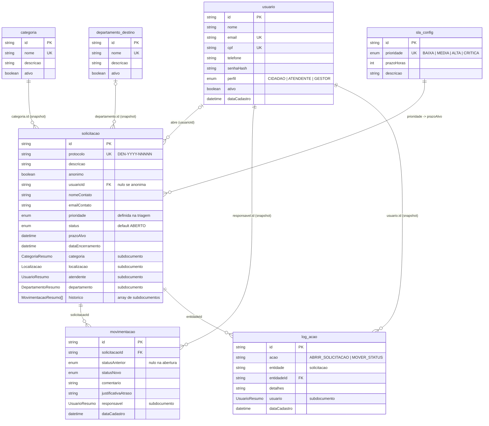

# Modelo de coleções (MongoDB)

Banco `aepdb`, sete coleções. Todas as entidades herdam de `DefaultEntity` (`id` e `dataCadastro`). Os índices únicos são criados automaticamente (`spring.data.mongodb.auto-index-creation=true`).

## Diagrama

Os relacionamentos são **referências por id**, sem `$lookup` nem `@DBRef`. Quando a solicitação precisa exibir dados de outra coleção, ela guarda uma cópia reduzida (um `Resumo`) no próprio documento.

## Coleções

| Coleção | Entidade | Papel | Exclusão |
|---|---|---|---|
| `usuario` | `Usuario` | Cidadãos, atendentes e gestores. Implementa `UserDetails` (login por e-mail). | Lógica: `ativo=false`. Nunca apagado, para preservar o histórico que o referencia. |
| `categoria` | `Categoria` | Tipo de problema (Lixo Irregular, Queimada, Manutenção Urbana, Poluição). | Lógica (`Ativavel`). |
| `departamento_destino` | `DepartamentoDestino` | Órgão que recebe o encaminhamento na triagem. | Lógica (`Ativavel`). |
| `sla_config` | `SlaConfig` | Prazo em horas por prioridade. Uma linha por prioridade. | Física. |
| `solicitacao` | `Solicitacao` | Denúncia. Entidade central. | Nunca é deletada, só encerrada. |
| `movimentacao` | `Movimentacao` | Uma linha por mudança de status, na ordem em que ocorreram. | Não se aplica. |
| `log_acao` | `LogAcao` | Auditoria das operações críticas. | Não se aplica. |

Índices únicos: `usuario.email`, `usuario.cpf`, `solicitacao.protocolo`, `categoria.nome`, `departamento_destino.nome`, `sla_config.prioridade`.

## Subdocumentos

Ficam dentro de `solicitacao` (e `movimentacao`/`log_acao` para `UsuarioResumo`). São `record`s Java, sem coleção própria.

### `localizacao` (`Localizacao`)

Onde está o problema. Preenchida no formulário; o CEP é resolvido via ViaCEP e as coordenadas via Nominatim/Leaflet no frontend.

| Campo | Tipo |
|---|---|
| `logradouro` | string |
| `bairro` | string |
| `cep` | string |
| `referencia` | string (ponto de referência) |
| `latitude` | double |
| `longitude` | double |

`latitude` e `longitude` alimentam o mapa (`/mapa`).

### `historico` (`MovimentacaoResumo[]`)

Linha do tempo embutida na solicitação, para consultar por protocolo sem segunda leitura.

| Campo | Tipo |
|---|---|
| `id` | id da `movimentacao` correspondente |
| `statusAnterior` | enum, nulo na abertura |
| `statusNovo` | enum |
| `comentario` | string |
| `responsavel` | `UsuarioResumo` |
| `justificativaAtraso` | string |
| `dataMovimentacao` | datetime (vem de `dataCadastro` da movimentação) |

Cada mudança de status grava a `Movimentacao` na coleção **e** acrescenta o resumo em `solicitacao.historico`, na mesma transação.

### Resumos de referência

Cópia congelada de `id` + `nome` no momento da operação. Se a categoria ou o usuário forem renomeados depois, o documento antigo mantém o nome original.

| Subdocumento | Campos | Onde aparece |
|---|---|---|
| `CategoriaResumo` | `id`, `nome` | `solicitacao.categoria` |
| `DepartamentoResumo` | `id`, `nome` | `solicitacao.departamento` (preenchido na triagem) |
| `UsuarioResumo` | `id`, `nome` | `solicitacao.atendente`, `movimentacao.responsavel`, `log_acao.usuario`, `historico[].responsavel` |

## Anônimas e protocolo

- Solicitação anônima tem `anonimo=true` e `usuarioId` nulo. `nomeContato` e `emailContato` são opcionais.
- `protocolo` segue `DEN-YYYY-NNNNN`: prefixo do ano mais contagem sequencial de protocolos do mesmo ano. É o único meio de acompanhar uma denúncia anônima.

## Transações

`SolicitacaoService.criar` e `moverStatus` são `@Transactional`: gravar `solicitacao`, `movimentacao` e `log_acao` é tudo ou nada. Transação no MongoDB exige **replica set**, mesmo com um único nó (veja o README).

## Dados iniciais

`DataInitializer` semeia, de forma idempotente, 3 usuários, 4 categorias, 6 departamentos e 4 configurações de SLA. Veja o README para a lista.
